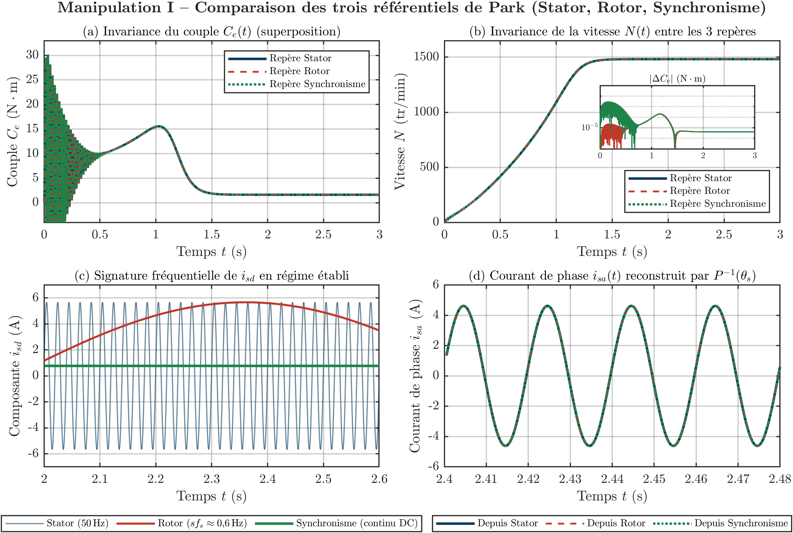

# Three-Phase Induction Motor Modeling & Control — Park Reference Frames, AC Dimmers & V/f Inverter (MATLAB)

> **Author:** Tsikomia Scidelo ANDRIASAHY — GSEA Engineering (ENSA Tangier)

## Overview
Complete numerical modeling (RK4 integration) and power-electronic control study of a three-phase squirrel-cage induction machine (MAS):
- **Park Reference Frame Analysis:** Stator, rotor, and synchronous (`dq0`) dynamic simulations under no-load, rated load, and pull-out torque stall conditions.
- **AC Voltage Controllers (Gradateurs):** Phase-angle vs. burst-firing (wave-train) speed regulation and harmonic THD spectral analysis (`calc_fft_thd.m`).
- **PWM V/f Inverter Drive:** Constant flux `V/f` scalar control for variable-speed operation.
